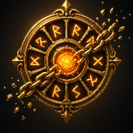
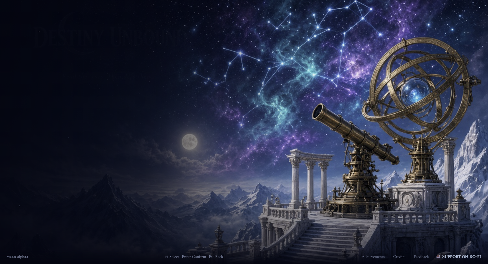
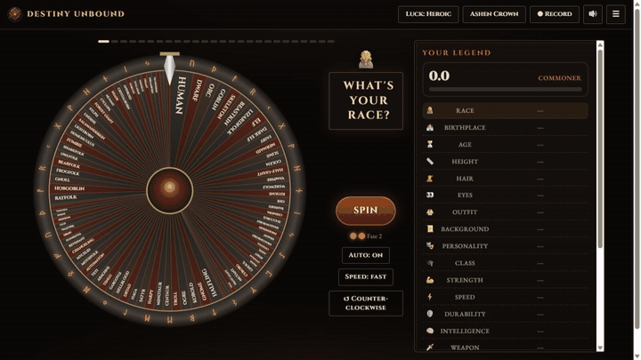
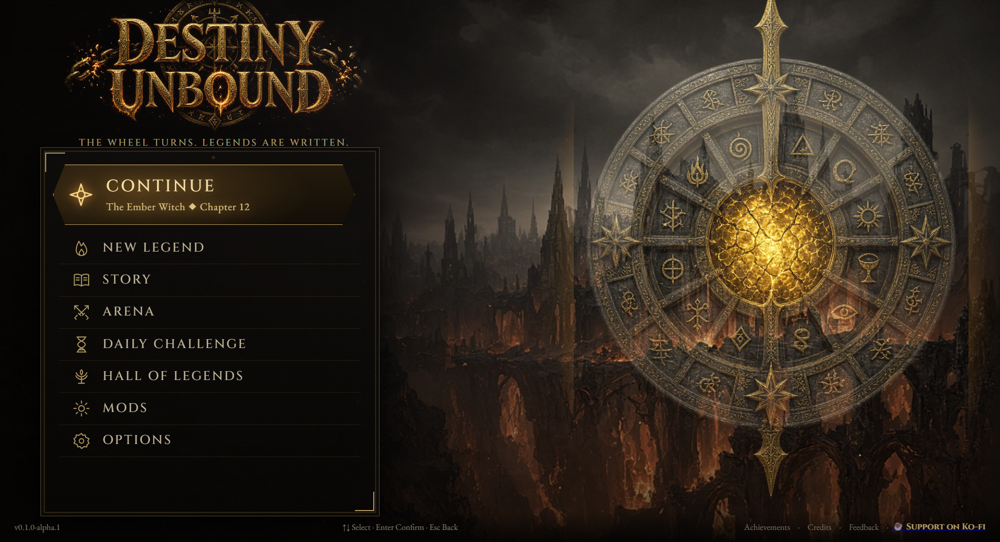
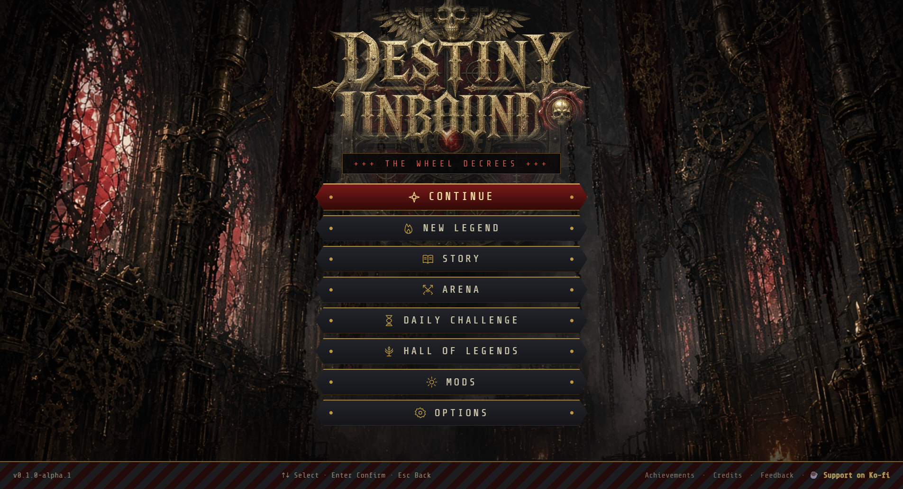
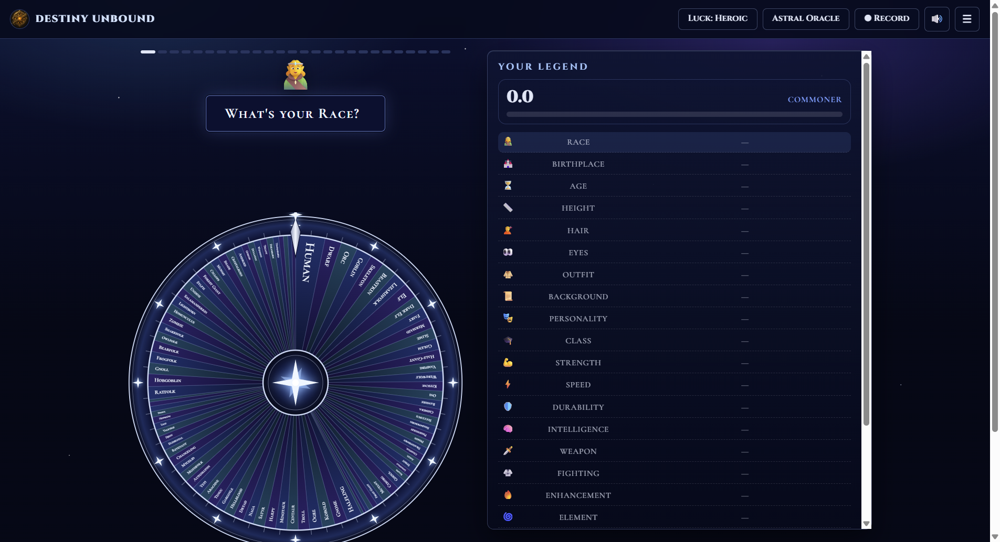
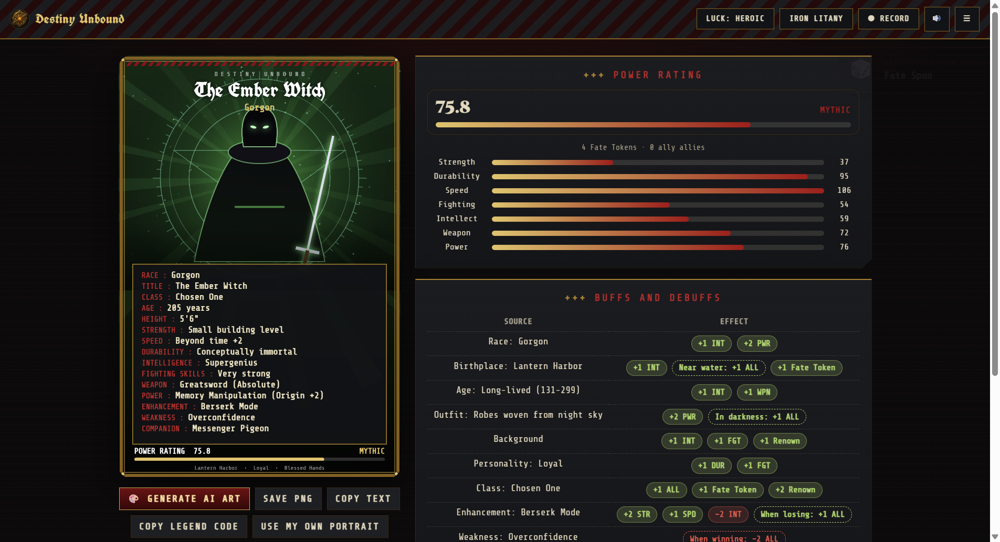
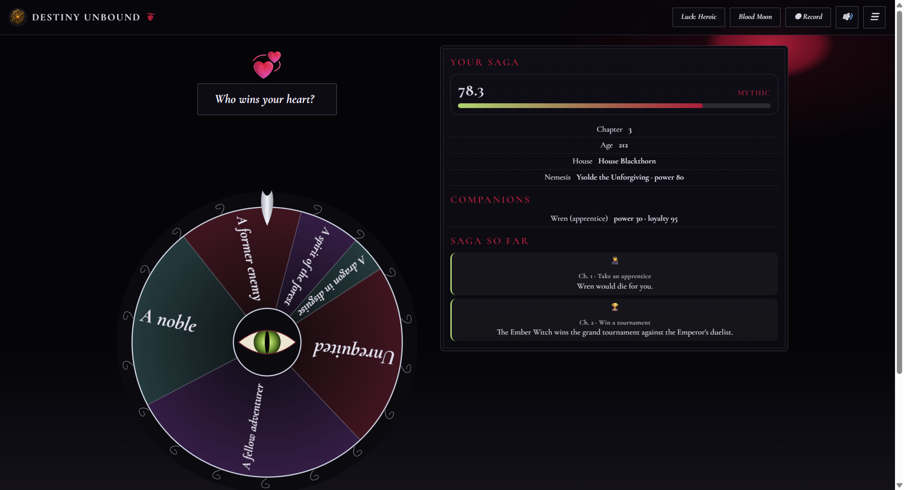
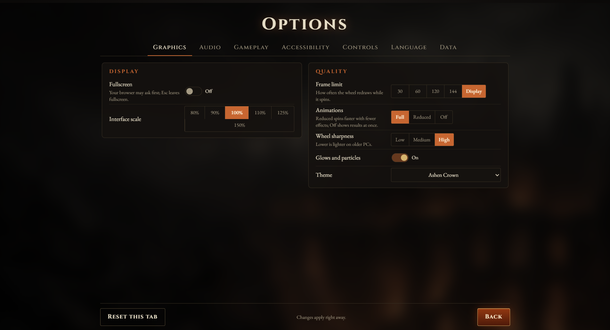

<div align="center">



# Destiny Unbound

**Spin the wheels of fate. Forge a legend. Live its story, or die trying.**

[](progress.md)
[](LICENSE)

[](https://bzrkherja.itch.io/destiny-unbound)
[](https://discord.gg/McDS5HVxzJ)
[](https://ko-fi.com/bzrkherja)



</div>

Destiny Unbound is a free, open-source character forge and story game. Every part of your hero is decided by a
wheel: race, birthplace, age, class, powers, weapon, weakness and more. Then you play out their saga, chapter by
chapter, until they retire, ascend or fall.

<div align="center">

</div>

> **Status: early alpha.** The game is playable from start to finish, but expect rough edges. See
> [progress.md](progress.md) for what is done and what is next, and [docs/alpha-testing.md](docs/alpha-testing.md)
> for the alpha test plan and known issues.

---

## Contents

- [Features](#features)
- [Screenshots](#screenshots)
- [Download](#download)
- [How it plays](#how-it-plays)
- [Make it your own](#make-it-your-own)
- [AI disclosure](#ai-disclosure)
- [Support the project](#support-the-project)
- [Building from source](#building-from-source)
- [License and credits](#license-and-credits)

## Features

- **Forge a legend.** Over 40 wheels and more than 1,400 entries, each with buffs and debuffs that move the
  other wheels up or down long stat ladders. Bigger slices are likelier, and four luck levels shift the odds.
- **Live the story.** A saga of 32 kinds of chapter: quests, dragons, kingdoms, wars, rivals, love and heirs.
  Death is a real outcome, and a dynasty can carry on through your heirs.
- **Fight in the arena.** 77 opponents across 13 worlds. Weaknesses, resistances and the arena itself shape
  the odds, and the wheel always shows the true chances.
- **Four painted themes.** Ashen Crown, Astral Oracle, Iron Litany and Blood Moon, each with its own title
  screen, wheel, character-card frame, sound effects and music.
- **Keep playing.** A daily challenge, the Hall of Legends, 34 achievements, versus mode and a vertical video
  recorder for sharing.
- **Built for everyone.** Full controller support, rebindable keys, colour-blind-safe wheels, high contrast,
  text size, reduced motion and sound captions. English, Spanish, French, German and Japanese.
- **Yours to change.** A Wheel Workshop to edit any wheel, plus wheel packs and mods for your own themes,
  sounds and entries.
- **Shows up on Discord.** The desktop app shows what you're playing in your Discord status, from "Living a
  saga · Chapter 4" to "Fighting in the arena". It only talks to the Discord app on your PC, and it can be switched off.
- **Respects players.** No ads, no accounts, no tracking. Works offline. Play stats stay on your PC.

## Screenshots

| | |
| --- | --- |
|  |  |
|  |  |
|  |  |

A 30-second teaser is in [docs/store/trailer.mp4](docs/store/trailer.mp4).

## Download

**Play it in your browser** on [itch.io](https://bzrkherja.itch.io/destiny-unbound), or download the Windows
installer (`DestinyUnbound-Setup-<version>.exe`) or the portable `.exe` from itch.io or the
[Releases](https://github.com/ScikuVRC/destiny-unbound/releases) page.

- **Installer:** installs for your user, adds a Start menu shortcut and updates itself.
- **Portable:** runs from anywhere and never updates itself.

The alpha is not code-signed yet, so Windows may show "Windows protected your PC". Choose **More info**, then
**Run anyway**.

You can also play in a browser by opening `app/index.html`.

**Your saves** are kept in `%APPDATA%\FateWheel` (the game's earlier name, so older saves carry over), with a
backup made every day. Options > Data can export your whole save to move it to another PC.

## How it plays

1. **Choose your luck and look**, then spin a new legend. You can name your hero and pick some results by hand.
2. **Spin each wheel.** Race, birthplace, age, height, looks, background, personality, class, six stat ladders,
   weapon, enhancement, element, power, weakness, companion, title and a mark of fate. Fate Tokens let you
   re-spin a result you dislike.
3. **Read the card.** A power rating, a rank from Commoner to Cosmic Being, and every buff and debuff.
4. **Begin the story** or **enter the arena.** Each story chapter opens its own follow-up wheels. Used
   chapters grey out, and retiring grows likelier with age.
5. **Carry on the line.** If your hero had an heir, continue as them, with the house name, an heirloom and
   any living nemesis.

The story features can be switched on or off in Options > Gameplay: chapter requirements, death, aging,
nemesis, kingdom events, companion loyalty, dynasty and achievements.

## Make it your own

- **Wheel Workshop:** make any result likelier or rarer, remove it, or add your own.
- **Wheel packs and mods:** add entries, themes, fonts, sounds and music. Mods can't run code, and everything they
  contain is checked when it loads. The **mod kit** (`DestinyUnbound-ModKit-<version>.zip` on the
  [Releases](https://github.com/ScikuVRC/destiny-unbound/releases) and itch.io pages, or [`modkit/`](modkit)) has a
  step-by-step guide, seven ready-to-copy templates and the full reference. The
  [modding page](docs/modding.md) is the short version.
- **Art Studio (optional):** paint a portrait of your hero with an image generator you already use, on your
  own PC or with your own API key. See [docs/art-studio.md](docs/art-studio.md).

## AI disclosure

Destiny Unbound is made by one person with no budget for a studio, artists or contractors. To make a game of
this size possible on my own, I used AI tools. In the spirit of transparency, here is exactly where:

| Area | How it was made |
| --- | --- |
| **Code** | Much of the code was written with an AI coding assistant (Claude, by Anthropic), directed, reviewed and play-tested by me. |
| **Game text** | Many wheel entries, story texts and the translations were drafted with AI help and then edited. |
| **Painted art** | Created with Grok. The title-screen backgrounds, wheel paintings, the four logos and the app icon were generated with Grok Imagine (xAI) and then composed into the game. Every image and its prompt is listed in [docs/art-credits.md](docs/art-credits.md). |
| **Everything else you see** | The playable wheels, character cards, icons and interface are drawn in code. |
| **Sound and music** | Synthesized in code. No AI audio. |
| **Optional AI features** | The Art Studio and the saga writer only run if you connect your own image generator or language model. They are off by default, and nothing is sent anywhere unless you set them up. |

AI was used because of a lack of personal funding, not to replace anyone's work. I want players to know
what they are getting, so this is disclosed here, in the game's credits and on the store page. If you'd rather
not support projects that use AI, I respect that choice.

## Privacy

The game keeps your saves and play stats on your own device. It sends nothing unless you switch something on:

- **World counter** (Options > Data, off by default): adds one anonymous count to everyone's totals each time you
  finish a hero or a saga ends. Only "a hero" or the name of the ending is sent: no names, legend codes or IDs.
  The totals are shown in Options and by `/stats` on the Discord. The counter's code is in [worker/](worker/).
- **Feedback reports** include your play stats only if you tick the box.
- **The Art Studio and the saga writer** only talk to an image generator or language model you connect yourself.

## Support the project

Destiny Unbound is free and always will be. If you enjoy it and want to support me and my future projects, you
can buy me a coffee on **[Ko-fi](https://ko-fi.com/bzrkherja)**. Bug reports, ideas and kind words help just as
much: join the **[Discord](https://discord.gg/McDS5HVxzJ)** (bug reports, suggestions, and a place to share your
legends and mods), open an [issue](https://github.com/ScikuVRC/destiny-unbound/issues), or use Options > Data > Send
feedback in the game.

## Building from source

Requires Node.js 20 or newer.

```bash
npm install
```

```bash
npm start
```

```bash
npm test
```

`npm run dist` builds the Windows installer and portable `.exe`. The [development guide](docs/development.md)
covers releases, automatic updates, code signing, test switches, where data is stored and the code layout.
Contributions are welcome. Please run `npm test` before opening a pull request.

## License and credits

Copyright © 2026 Destiny Unbound contributors.

Destiny Unbound is free software: you can redistribute it and/or modify it under the terms of the
[GNU General Public License](LICENSE), version 3 or (at your option) any later version. It is distributed in the
hope that it will be useful, but **without any warranty**; see the license for details.

- **Fonts:** Cinzel, Cormorant Garamond, Cormorant SC, EB Garamond, IM Fell English, Share Tech Mono and
  UnifrakturCook, each under the SIL Open Font License 1.1 (license files in `app/fonts`).
- **Painted art:** Created with Grok (Grok Imagine, by xAI) for this game; see [docs/art-credits.md](docs/art-credits.md).
- **Built with:** [Electron](https://www.electronjs.org/) and electron-updater (MIT).
